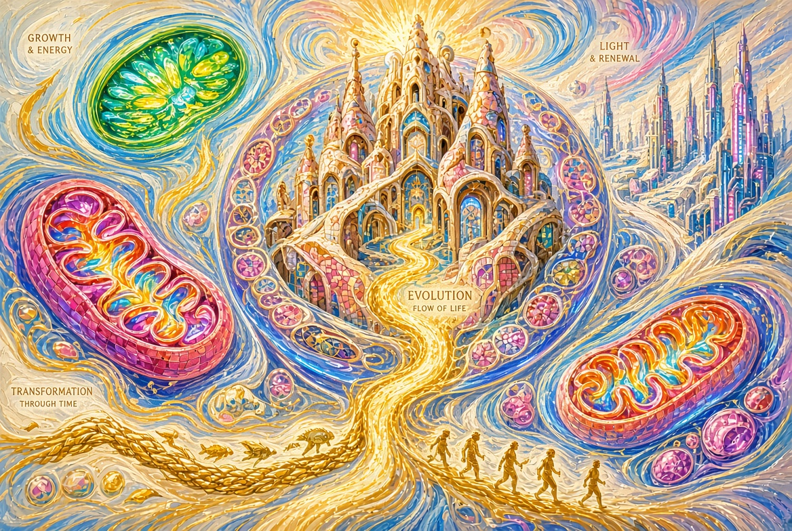
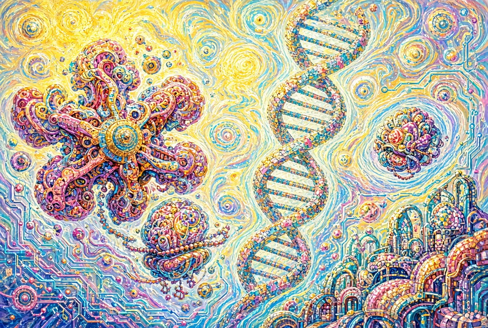

# Evolution

**Book IV of the Cycle “Creator’s Theorem”**

---

## Prologue. When a Second Lasts an Eternity

At the nano level time flows differently.

What for a human is an instant,  
for molecular machines is a long, event-rich history.  
Replication, translation, protein folding, error correction —  
all of this happens in a regime  
where a second becomes almost an epoch.

This book is about how information becomes a working machine,  
and about how the speed of these processes forces us to feel Time in a new way.

---

## Chapter 1. The Text That Builds a Machine

DNA stores the text.  
RNA reads it.  
The ribosome translates it into an amino-acid chain.  
The chain folds into a three-dimensional machine.

This is not a metaphor.  
This is a directed information flow  
with a clear architecture at every stage.

The central dogma is not merely a scheme.  
It is a description of how meaning (sequence)  
becomes function (protein).

Engineering already appears at the level of language:  
there is a carrier, there is reading, there is translation, there is assembly.

---

## Chapter 2. The Nano-Factory

The ribosome.

Dozens of proteins and RNA molecules.  
Precise geometry.  
Step-by-step synthesis.  
The ability to work in parallel — thousands of copies in one cell.

It does not merely “make proteins.”  
It prints the parts of future machines  
with high accuracy and speed.

Each new polypeptide chain  
is a blank that is almost immediately sent  
into the space of possible forms.

---

## Chapter 3. Copying with Almost Zero Error

DNA replication.

Speed — hundreds of nucleotides per second per fork (in bacteria).  
In a human cell, during one division,  
billions of base pairs are copied.

At the same time the final error after correction systems  
is one in billions.

This is not crude copying.  
This is a multi-level system:  
polymerase, proofreading, mismatch repair, additional mechanisms.

Complexity does not grow linearly.  
It is hierarchical.

It is not enough to copy the information.  
It must be copied so that  
the next level of organisation does not collapse.

---

## Chapter 4. A Speed Hard to Feel

Let us translate molecular processes into human units.

The replication fork moves at a speed  
that looks rapid on the scale of the cell.  
The ribosome adds amino acids by the dozens per second.  
Proteins fold in a time  
that is almost imperceptible to us.

If we could slow time  
to the scale of these machines,  
we would see not “instantaneous” events  
but long, coordinated, almost technological processes.

Speed here is not chaos.  
Speed here is a sign of fine tuning.

---

## Chapter 5. Levinthal’s Paradox and Protein Folding

A protein of a hundred amino acids could theoretically adopt  
an astronomical number of conformations.  
If it searched through them at random,  
the age of the Universe would not be enough.

Yet proteins fold in milliseconds or seconds.

This is Levinthal’s paradox.

It shows:  
random search at the nano level does not work.  
The folding process is directed.

There exists an energy landscape with a funnel.  
The correct form is a deep minimum.  
Intermediate states already strongly limit the search.  
Many proteins begin to fold while still being synthesised on the ribosome.  
Chaperones help complex cases not to get stuck.

Matter here does not search in the dark.  
It moves along paths that are preferred in advance.

The search space is narrowed.  
This looks like a property of a system  
into which the possibility of rapid and accurate assembly  
was built from the start.

---

## Chapter 6. Regulation and Timing of Activation

It is not enough to produce a part.  
It must be produced at the right time,  
in the right quantity  
and in the right place.

The genome contains not only protein sequences  
but an enormous regulatory apparatus:  
when to switch on, when to switch off,  
how to respond to signals,  
how to coordinate the work of thousands of genes.

Evolution at this level  
is no longer only a change of text,  
but a fine tuning of the time of its reading.

---

## Chapter 7. Front-Loading

The genome carries not only the current instruction.  
It carries potential.

Many possibilities of future states  
are already present in the form of regulatory networks,  
duplicated genes,  
hidden developmental programmes.

Evolution in this light  
is not the creation of complexity from nothing,  
but the unfolding, combinatorics and modification  
of an already existing architecture.

Selection works.  
But it works with material  
that already possesses high organisation.

---

## Chapter 8. Different Clocks of One Reality

A molecule lives in one tempo.  
A human in another.  
A possible eternal mind in a third.

The same events  
have different duration and density  
for different subjects.

What for a human is an instant of protein folding  
is for a molecular system a whole history of searching for a minimum.  
What for a human is a life  
may look to an eternal observer  
like a short, bright, dense episode.

Evolution shows:  
time is not uniform.  
It depends on the level of organisation  
and on who (or what) perceives.

It is precisely here that this book directly touches the next one — “Time.”

---

## Epilogue

Information becomes a machine.  
The machine sustains information.  
The cycle is closed and at the same time open.

At the nano level entropy is not defeated forever —  
it is subordinated long enough  
for complexity to unfold  
and for the spectator to appear.

And when the spectator himself begins to move  
beyond the biological tempo,  
evolution will not end.  
It will simply change its carrier.

---

*Book “Evolution” · Cycle “Creator’s Theorem” · Version 1.0*
