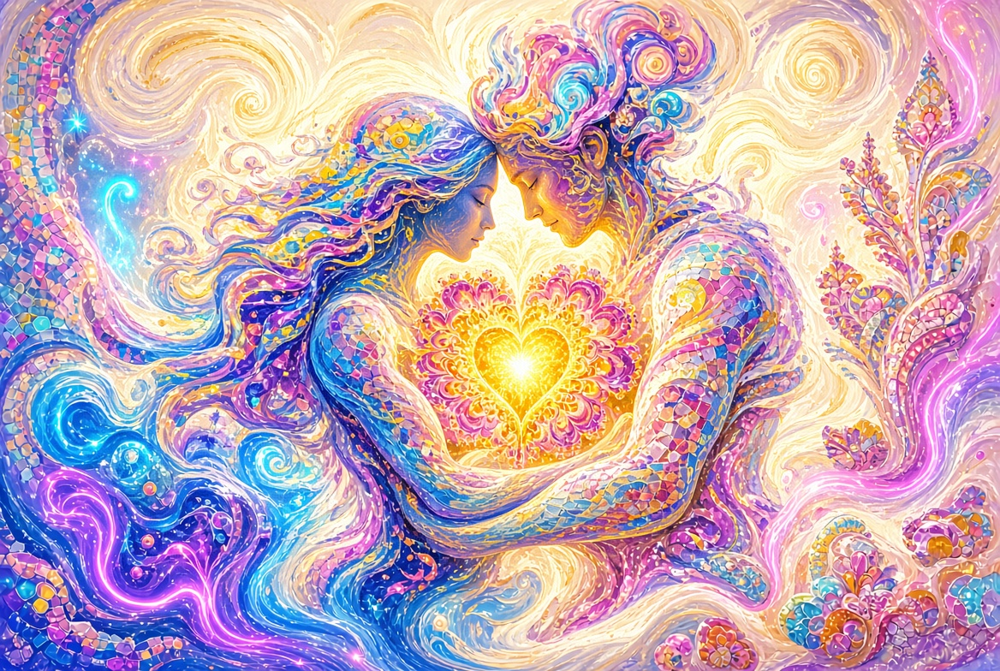

# Cuidado

**Libro II del Ciclo «Teorema del Creador»**

---

## Prólogo. El Escenario Ya Estaba Listo

Cuando se abrieron los primeros ojos, el Escenario ya estaba en pie.

El cielo ya tenía su color.  
La Luna ya ocupaba casi exactamente el mismo tamaño angular en el cielo que el Sol.  
El aire ya dejaba pasar la luz necesaria y retenía el resto.  
Las plantas ya sabían capturar fotones y plegarlos en azúcar.  
Y en la hierba ya se sentaba una pequeña criatura de pupilas verticales que más tarde se tumbaría en el regazo de un humano y ronronearía a una frecuencia cercana a la curativa.

Todo esto existía antes de que alguien pudiera apreciarlo.

El Escenario no apareció junto con el espectador.  
El espectador apareció dentro de un Escenario ya preparado.

Esto es el Cuidado en su sentido más simple y más fuerte:  
el espacio fue preparado de antemano.

---

## Capítulo 1. El Espectador

La mayoría de los seres vivos resuelven un solo problema: continuar siendo.  
El humano resuelve otro: comprender que es.

No solo ve. Mira.  
No solo oye. Escucha.  
No solo siente dolor o placer: es capaz de detenerse y preguntar: «¿Por qué está esto dispuesto exactamente así?»

Esta capacidad es excesiva desde el punto de vista de la mera supervivencia.  
Es costosa. El cerebro consume una cantidad desproporcionada de energía.  
Y sin embargo apareció.

El espectador no es un producto secundario.  
Es aquel para quien, al parecer, se construyó la sala.

---

## Capítulo 2. La Escenografía

### Cosmos y Planeta

El Universo podría haber sido diferente.  
Las constantes podrían no haber coincidido.  
La estrella podría haber ardido demasiado caliente o demasiado rápido.  
El planeta podría no haber retenido la atmósfera.

Pero los parámetros coincidieron.  
Y coincidieron de tal modo que en la superficie aparecieron agua líquida, química compleja y largos intervalos de estabilidad.

### La Luna

La Luna no es solo un satélite.  
Estabiliza el eje de rotación de la Tierra.  
Crea mareas.  
Y —lo más extraño— su tamaño aparente coincide casi exactamente con el tamaño aparente del Sol.

Por eso vemos eclipses solares totales.  
Una coincidencia rara, casi teatral.  
¿Necesaria para la vida? No.  
¿Necesaria para el asombro? Sí.

Este es uno de los ejemplos más puros de exceso.  
Ingeniería que no se limita a la función, sino que añade espectáculo.

---

## Capítulo 3. El Atrezo. Las Plantas

Entre todas las plantas, una ocupa un lugar especial.

El cáñamo.

Proporciona:

- proteína completa en sus semillas,
- aceites con un perfil raro de ácidos grasos,
- fibra larga y resistente,
- celulosa,
- todo un espectro de sustancias que afectan al sistema nervioso humano,
- crecimiento rápido y resistencia.

Una sola planta cubre de una vez varias necesidades fundamentales de la especie *Homo sapiens*: alimento, ropa, material, medicina, incluso estados alterados de conciencia.

Esto no parece una coincidencia aleatoria de propiedades,  
sino una herramienta ajustada a un usuario concreto.

Otras plantas también son generosas.  
Pero el cáñamo reunió en sí un conjunto casi completo «para el humano» con una plenitud sorprendente.

---

## Capítulo 4. Los Compañeros

El gato no se hizo doméstico porque el humano lo domesticara.  
Más bien, permitió al humano estar cerca.

Caza plagas.  
Emite un sonido de baja frecuencia que, según algunos datos, favorece la cicatrización ósea.  
Elige cuándo estar cerca y cuándo guardar distancia.  
Mira al humano como si lo evaluara.

El perro eligió otro camino: una fusión casi completa con la manada humana.  
Pero el gato conservó su independencia y aun así se quedó.

Junto al humano aparecieron seres que no solo son útiles,  
sino capaces de entrar en relaciones en las que hay reconocimiento mutuo.

Esto ya no es solo ecología.  
Es compañía.

---

## Capítulo 5. La Dirección Invisible

Hay cosas que no se requieren para la supervivencia y sin embargo están presentes en todas partes.

**Belleza.**  
Simetría, fractales, proporción áurea, iridiscencias en las alas de los insectos, forma de las conchas, estructura de los copos de nieve.  
La naturaleza podría haber sido solo eficiente. Resultó ser también bella.

**Armonía del sonido.**  
Ciertas relaciones matemáticas de los tonos resultan agradables a casi todas las personas.  
Como si se hubiera incorporado de antemano una resonancia al sistema auditivo.

**Risa y lágrimas.**  
Reacciones fisiológicas que ayudan poco en la lucha por la existencia, pero dan mucho para la conexión y la experiencia de sentido.

**Sueño y sueños.**  
Cada noche el sistema se apaga y proyecta un cine interior.  
Una función extraña, costosa e innecesaria.

**La capacidad de asombrarse.**  
Quizá lo más importante de todo.  
Sin asombro ningún Escenario funciona.  
El asombro es cuando el espectador comprende que está viendo algo mayor de lo que esperaba.

Todo esto junto crea la sensación de que el director pensó no solo en que la representación continuara,  
sino también en que el espectador tuviera algo que vivir.

---

## Capítulo 6. El Cuidado que No Grita

Lo más fuerte de este Cuidado es su modestia.

No escribe «Estoy aquí» en el cielo.  
Permite parecer «solo naturaleza».  
Deja la libertad de no darse cuenta.

Se puede vivir toda una vida creyendo que los eclipses son casualidad,  
el cáñamo es solo una mala hierba,  
el gato es solo un depredador,  
y la belleza es un efecto secundario de la simetría.

Se puede.  
Y muchos lo hacen.

Pero si uno empieza a mirar con más atención,  
la propia modestia del Cuidado se convierte en otra de sus propiedades.  
No obliga.  
Ofrece.

---

## Epílogo

Cuando el humano empieza a sospechar que el Escenario fue preparado,  
algo cambia en su interior.

Aparece la gratitud —aunque no haya a quién dirigirla directamente.  
Aparece la cautela —porque el espacio ahora parece más significativo.  
Aparece la responsabilidad del espectador —porque una buena sala obliga.

Y aparece una alegría callada:  
resulta que no solo se puede sobrevivir en este mundo,  
sino ser un invitado bienvenido en él.

El Cuidado no abolió la entropía.  
La subordinó el tiempo suficiente  
para que en el Escenario pudiera aparecer  
quien es capaz de notar este Cuidado.

---

*Libro «Cuidado» · Ciclo «Teorema del Creador» · Versión 1.0*
