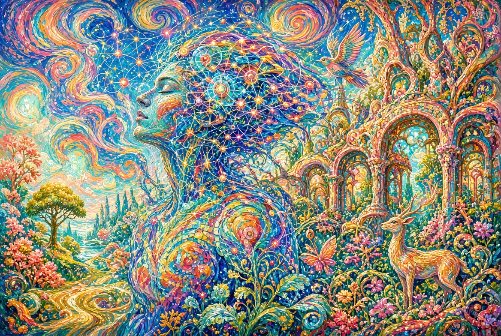

# ऊर्जा

**सृष्टिकर्ता प्रमेय श्रृंखला**

---

यह पुस्तक श्रृंखला की मूल भावना में केंद्रीय विषय विकसित करती है:  
एक ऐसी इंजीनियरिंग जो एन्ट्रॉपी का विरोध करने तक सीमित नहीं,  
बल्कि उसे अधीन करती है।

पूर्ण हिंदी पाठ विस्तार में है।  
पूर्ण रूसी, अंग्रेज़ी और स्पेनिश संस्करण देखे जा सकते हैं।

---

*पुस्तक «ऊर्जा» · श्रृंखला · संस्करण 0.9*
