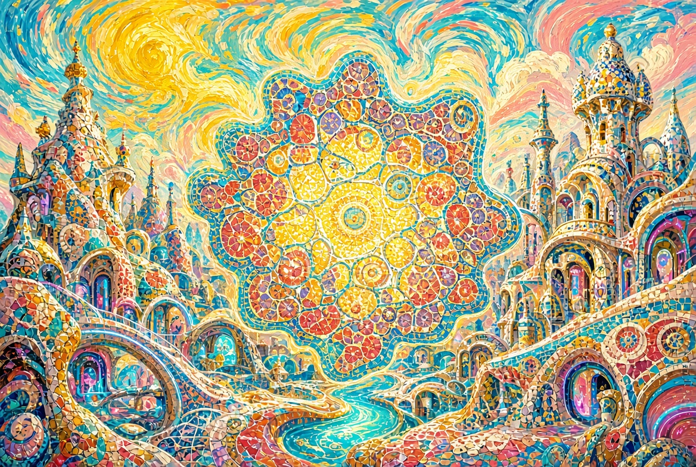

# Теорема Творца

**Полный цикл на русском языке**

Пять книг одного замысла.

Инженерия, невозможная без Инженера.  
Не просто преодоление энтропии — её подчинение.

---

## Книги

| № | Книга | Файл |
|---|-------|------|
| I | Теорема Творца | [00-theorem.md](./00-theorem.md) |
| II | Забота | [01-care.md](./01-care.md) |
| III | Энергия | [02-energy.md](./02-energy.md) |
| IV | Эволюция | [03-evolution.md](./03-evolution.md) |
| V | Время | [04-time.md](./04-time.md) |

**Полная книга целиком:** [full-cycle.md](./full-cycle.md)

---

## Иллюстрации

Все изображения выполнены в едином стиле:  
киберпанк + Ван Гог + Гауди (светлая яркая версия).

---

[← Назад к выбору языка](../README.md)
